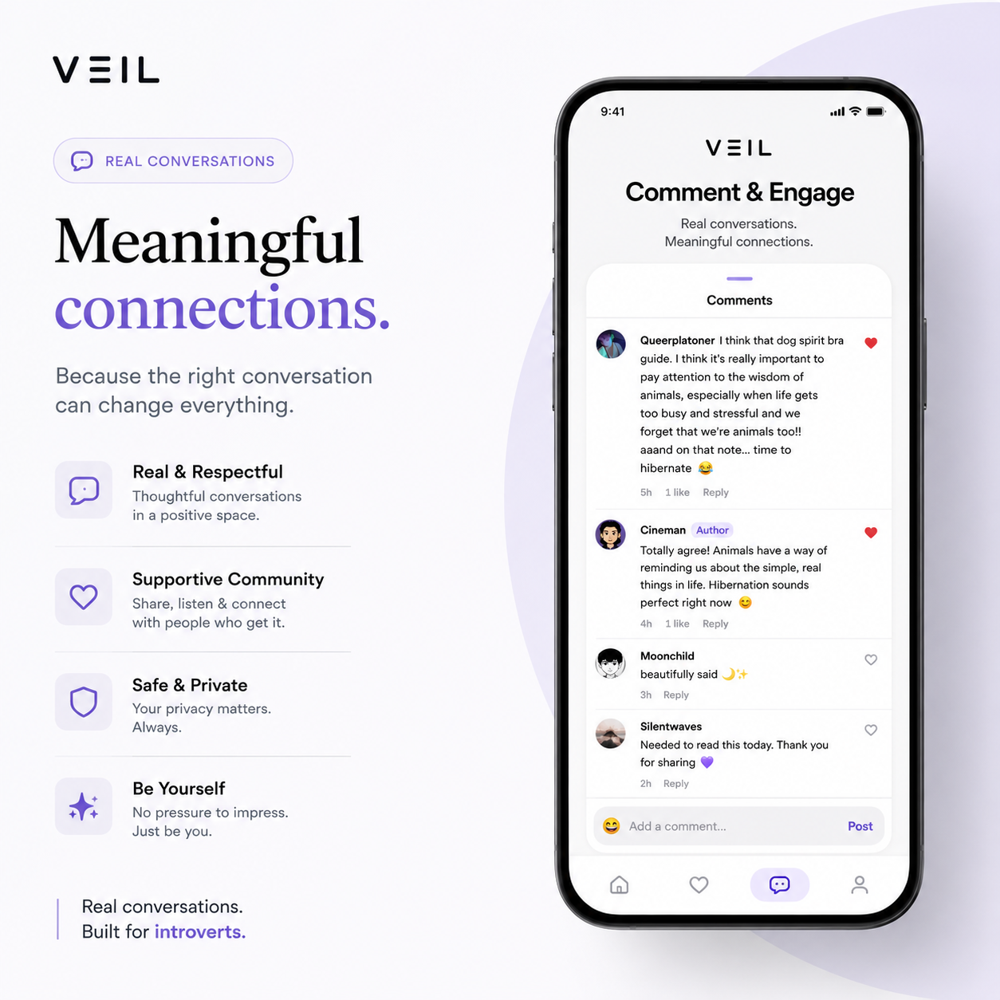
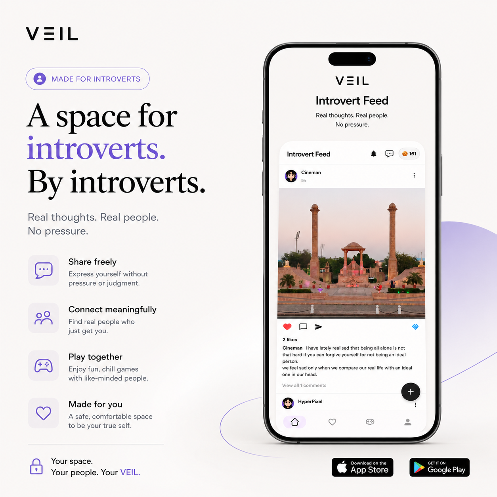
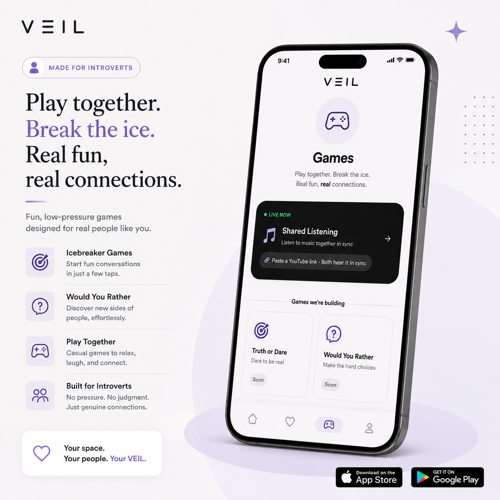

# Veil — A Social App Built for Introverts

> Real conversations. Meaningful connections. No pressure.

**Live on Google Play:** [Download Veil](https://play.google.com/store/apps/details?id=com.ns.findyourintroverfriend)

---



---

## The Story

Most social apps are designed for extroverts. Loud feeds, follower counts, public likes, the pressure to perform. They optimise for attention, not connection.

Veil was built for the people who prefer depth over breadth. The ones who take time to warm up, who have a lot to say once they trust you, who find small talk exhausting but long conversations energising.

The core idea is simple: instead of throwing you into a noisy public space, Veil matches you into a private circle of four people. You spend three days together — talking slowly, playing low-pressure games, sharing thoughts anonymously — before anyone knows who anyone is. On day three, identities are revealed. By then, you already know whether you want to keep talking.

That is the complete loop: anonymous bonding, gradual trust, optional reveal.

Alongside the circle experience, Veil has an anonymous community feed, a swipe-to-match feature for one-on-one connections, an AI companion for when you want to talk without judgment, and voice rooms for real-time audio with people you have already connected with.

---

## Screenshots

| Introvert Feed | Community | Games |
|---|---|---|
|  |  |  |

---

## Core Features

### The Circle — 3-Day Matching (In Development)

The flagship feature. All screens and backend logic are built; the matching flow is currently disabled while stability and edge cases are finalised before public launch.

The concept: four strangers are matched into a private group and go through a structured three-day experience together before identities are revealed.

- **Day 1** — Slow chat (one message per day), anonymous question cards, icebreaker games
- **Day 2** — Secret compliments, Truth or Myth, shared listening, Would You Rather
- **Day 3** — Reveal ceremony with animations, followed by an optional continued connection

The deliberate pacing is the point. Real trust does not form in five minutes.

Screens built: `WaitingRoomScreen`, `RoomLobbyScreen`, `PartyIslandScreen`, `RevealCeremonyScreen`, `SlowChatScreen`, `SecretComplimentScreen`, `TrueOrMythScreen`, `ListeningRoomScreen`, `WouldYouRatherScreen`, `VibesScreen`, `KnowEachOtherScreen`.

### Introvert Feed
An anonymous social feed where users post thoughts, photos, and reflections. No follower count. No public performance. Just expression.

### Swipe Matching
A card-based swipe interface (with spring physics and LIKE/NOPE stamps) for finding one-on-one connections. Matches open a private chat room.

### AI Companion
A conversational AI friend for when you want to process thoughts, practice social situations, or simply have someone to talk to without judgment.

### Voice Rooms
Real-time audio rooms powered by LiveKit, accessible after establishing a connection with someone. Structured for introvert-paced conversation.

### Profile Themes
A light monetisation layer — users can purchase visual themes for their profile cards, keeping the core experience completely free.

---

## Tech Stack

| Layer | Technology |
|---|---|
| Language | Kotlin |
| UI Framework | Jetpack Compose + Material 3 |
| Architecture | MVVM, single-Activity, Navigation Compose |
| Backend | Firebase (Auth, Firestore, Storage, Functions, Crashlytics, Performance, App Check) |
| Real-time Audio | LiveKit (voice rooms) |
| Push Notifications | OneSignal |
| Image Loading | Coil |
| Image Upload | Cloudinary |
| On-device AI | ML Kit (face detection, image labelling for content moderation) |
| Billing | Google Play Billing 8.0.0 |
| Background Work | WorkManager |
| Edge Functions | Cloudflare Workers |
| Min SDK | 28 (Android 9) |
| Target SDK | 36 |

---

## Project Structure

```
.
├── app/
│   ├── src/main/java/com/ns/findyourintroverfriend/
│   │   ├── MainActivity.kt          # Single Activity host, navigation graph
│   │   ├── VeilApplication.kt       # App initialisation (Firebase, OneSignal)
│   │   │
│   │   ├── auth/                    # Phone + Google sign-in
│   │   ├── home/                    # VeilHomeScreen — main hub
│   │   ├── feed/                    # Introvert Feed (anonymous posts)
│   │   ├── swipe/                   # Card swipe, matches list
│   │   ├── chat/                    # Real-time chat within circles
│   │   ├── groupchat/               # Group chat rooms
│   │   ├── lobby/                   # Waiting room, room lobby, active rooms
│   │   ├── party/                   # Island screen, 3-day circle experience
│   │   ├── day2/                    # Day 2 activities (compliments, dares)
│   │   ├── reveal/                  # Reveal ceremony screen
│   │   ├── aifriend/                # AI companion chat
│   │   ├── voiceroom/               # LiveKit voice rooms
│   │   ├── listening/               # Shared listening feature
│   │   ├── game/                    # Tic Tac Toe
│   │   ├── question/                # Question card system
│   │   ├── answer/                  # Answer card system
│   │   ├── poll/                    # Would You Rather
│   │   ├── myth/                    # True or Myth game
│   │   ├── vibes/                   # Vibes / mood sharing
│   │   ├── invite/                  # Game invite system
│   │   ├── inbox/                   # Notifications and question inbox
│   │   ├── profile/                 # Profile setup, swipe profile
│   │   ├── themes/                  # Profile themes (purchasable)
│   │   ├── billing/                 # Google Play Billing integration
│   │   ├── payment/                 # Chat unlock, credits purchase
│   │   ├── report/                  # User / content reporting
│   │   ├── notifications/           # Push notification handling
│   │   ├── aesthetics/              # Aesthetics feed variant
│   │   ├── navigation/              # Compose Navigation setup
│   │   ├── data/                    # Shared data models
│   │   ├── ui/                      # Shared UI components, theme
│   │   ├── util/                    # Utilities (extensions, helpers)
│   │   ├── admin/                   # Admin dashboard (internal)
│   │   ├── founders/                # About / founders screen
│   │   └── dev/                     # Dev inspector (debug builds only)
│   │
│   ├── src/main/res/                # Resources (drawables, strings, etc.)
│   └── build.gradle.kts             # App-level build config
│
├── functions/                       # Firebase Cloud Functions (Node.js)
├── cloudflare-worker/               # Cloudflare edge functions
├── veil-api/                        # Payment verification & order APIs
├── website/                         # Landing page web assets
├── docs/                            # Project documentation
│   ├── features/                    # Feature specs, guides, screen flows
│   ├── dev-notes/                   # Development history, rules & build fixes
│   ├── internal/                    # Planning, moderation lists & research
│   └── assets/                      # App screenshots & promotional assets
├── scripts/                         # Project maintenance & utility scripts
├── firestore.rules                  # Firestore security rules
├── storage.rules                    # Firebase Storage security rules
├── firestore.indexes.json           # Firestore composite indexes
└── build.gradle.kts                 # Root build config
```

---

## Local Setup

### Prerequisites
- Android Studio Hedgehog or later
- JDK 11
- A Firebase project with the following services enabled: Authentication (Phone + Google), Firestore, Storage, Functions, Crashlytics, App Check

### Steps

1. **Clone the repository**
   ```bash
   git clone https://github.com/your-username/veil-android.git
   cd veil-android
   ```

2. **Add Firebase configuration**
   - Download `google-services.json` from your Firebase project console
   - Place it at `app/google-services.json`
   - This file is excluded from version control (see `.gitignore`)

3. **Create `local.properties`** in the project root:
   ```properties
   sdk.dir=/path/to/your/android/sdk

   # Cloudinary (for image uploads)
   cloudinary.cloud.name=your_cloud_name
   cloudinary.upload.preset=your_upload_preset

   # LiveKit (for voice rooms)
   livekit.host=wss://your-livekit-instance.livekit.cloud
   livekit.token.url=https://your-token-server/token
   ```

4. **Create `keystore.properties`** in the project root (release builds only):
   ```properties
   storeFile=path/to/your/keystore.jks
   storePassword=your_store_password
   keyAlias=your_key_alias
   keyPassword=your_key_password
   ```

5. **Set up Firebase Functions**
   ```bash
   cd functions
   cp .env.example .env   # fill in your API keys
   npm install
   firebase deploy --only functions
   ```

6. **Build and run**
   ```bash
   ./gradlew assembleDebug
   ```

> Neither `google-services.json`, `local.properties`, nor `keystore.properties` should ever be committed to version control. All three are listed in `.gitignore`.

---

## Security and Secrets

The following files are excluded from version control:

| File | What it contains |
|---|---|
| `app/google-services.json` | Firebase project credentials |
| `local.properties` | Cloudinary keys, LiveKit host, Android SDK path |
| `keystore.properties` | Release signing credentials |
| `*.keystore`, `*.jks` | Signing keystores |
| `functions/.env` | Cloud Function API keys (AI, etc.) |

If you are forking this project, never commit any of the above. Rotate any keys that have been accidentally exposed before removing them from history.

---

## Commit Convention

This project follows conventional commits going forward:

```
feat: add anonymous question card system
feat: implement 3-day reveal ceremony
feat: add LiveKit voice rooms
fix: resolve Firestore listener leak on lobby exit
fix: correct profile photo orientation from EXIF metadata
perf: reduce APK size with ABI splits
refactor: extract billing logic into dedicated module
docs: update local setup instructions
chore: upgrade Firebase BOM to 33.9.0
```

Format: `type(optional-scope): short description`

Types: `feat`, `fix`, `perf`, `refactor`, `docs`, `chore`, `test`

---

## Screen Count

The app currently ships **47 screens** across the following categories:

| Category | Count |
|---|---|
| Main navigation | 4 |
| Circle and room management | 6 |
| Chat and messaging | 4 |
| Games and activities | 9 |
| Day-specific activities | 5 |
| Profile and authentication | 5 |
| Payment and monetisation | 2 |
| Information and admin | 3 |
| Aesthetics and reporting | 2 |
| Loading and skeleton states | 7 |
| **Total** | **47** |

---

## Roadmap

### In Progress
- **Circle matching — public launch** — All screens are complete. Final work covers queue stability, edge-case handling (user drops mid-circle), and admin moderation tooling before the flow is enabled for all users.

### Planned
- Direct messages list (Instagram-style, for post interactions and swipe matches)
- Group voice rooms for circles
- Expanded game library (Truth or Dare, Would You Rather — UI exists, backend integration in progress)
- iOS version

---

## License

This project is proprietary. All rights reserved. The source code is shared for reference and portfolio purposes only. You may not use, distribute, or modify it without explicit written permission from the authors.

---

*Built with care for people who think deeply, connect slowly, and feel everything.*
